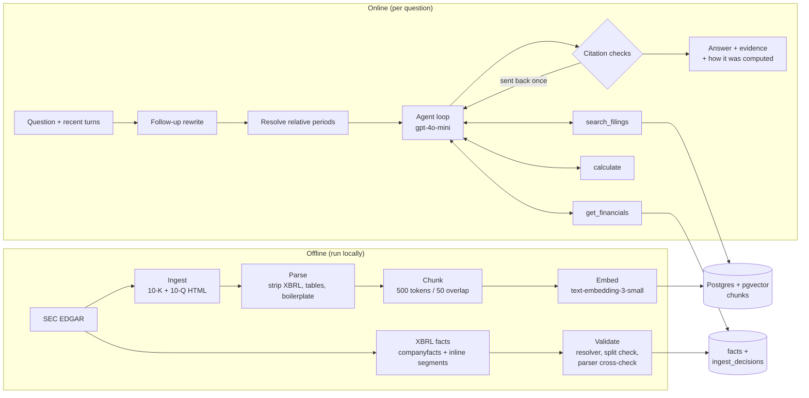
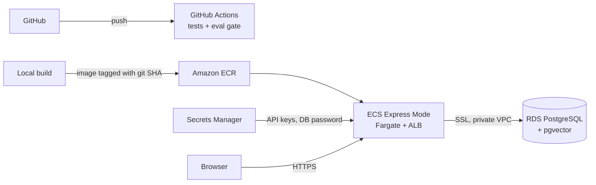

# Earnings RAG

[](https://github.com/dennisdang5/earnings-rag/actions/workflows/ci.yml)

Ask questions about NVIDIA, Apple, and Capital One's SEC filings and get answers drawn only from what the companies reported. A tool-using agent searches the 10-K and 10-Q text, looks up structured XBRL figures, does arithmetic in a calculator instead of in its head, and cites every claim and every number. Code checks the citations before the answer is shown.

**Live demo:** [ea-f1d2aa79276a44b6bd633fd808d49629.ecs.us-east-1.on.aws](https://ea-f1d2aa79276a44b6bd633fd808d49629.ecs.us-east-1.on.aws/)

The system covers the whole path end to end:
- SEC ingestion, parsing, chunking, embedding and vector search.
- Structured financial facts from XBRL.
- A hand-rolled agent loop with three tools and deterministic answer checks.
- A streaming conversational UI that shows how each answer was computed.
- An evaluation harness: a retrieval gate in CI, plus live agent evals with an LLM judge validated against human labels.
- A deployment on AWS.

The original fixed retrieve-then-generate pipeline (`/ask`) is still there. It serves as the baseline and stays under the CI recall gate.

---

## Tech stack

| Layer | Tools |
|---|---|
| Language | Python 3.11 |
| Ingestion | SEC EDGAR APIs (filings, companyfacts XBRL, calculation and label linkbases) |
| Parsing | BeautifulSoup, lxml |
| Embeddings | OpenAI `text-embedding-3-small` |
| Vector store | PostgreSQL + pgvector |
| Generation / agent | OpenAI `gpt-4o-mini`, hand-rolled tool loop (no framework) |
| Eval judge | OpenAI `gpt-4o` |
| API | FastAPI, Pydantic, Server-Sent Events |
| Frontend | HTML, JavaScript (no framework) |
| Observability | Prometheus, structlog |
| Containers | Docker, Docker Compose |
| CI | GitHub Actions |
| Cloud | AWS ECR, ECS, RDS, Secrets Manager |

---

## Architecture



**Offline**, filings are downloaded once and cleaned. The text is split into overlapping token windows, embedded and stored. Separately, the SEC's XBRL data becomes a `facts` table: consolidated figures from the companyfacts API, and product, segment and geography slices parsed from the inline XBRL in the filings. Each step is validated before anything is stored.

**Per question**, a follow-up such as "And Apple?" is first rewritten into a standalone question. Phrases like "last quarter" or "last year" are then resolved to fiscal periods for each company. After that, the agent decides which tools to call. Its draft answer goes through deterministic checks, and if a check fails the draft is sent back once to be fixed.

### Corpus

Four 10-Ks and every 10-Q since then for each company: 4,409 text chunks, plus 2,575 structured facts.

| Company | 10-Ks (fiscal years) | 10-Qs | Chunks | Facts (consolidated / slices) |
|---|---|---|---|---|
| NVIDIA | FY2023–2026 | Q1 FY2023 – Q2 FY2027 (14) | 1,163 | 321 / 364 |
| Apple | FY2022–2025 | Q1 FY2022 – Q3 FY2026 (15) | 587 | 292 / 528 |
| Capital One | FY2022–2025 | Q1 FY2022 – Q2 FY2026 (14) | 2,659 | 334 / 736 |

### Pipeline details

- **Ingestion** resolves tickers to SEC CIKs, walks each company's filing history, and downloads the primary 10-K and 10-Q documents. Downloads are cached, so a re-run fetches nothing new.
- **Parsing** removes the hidden inline-XBRL header and unwraps inline tags so that words split across `<span>` boundaries join again. It drops tables and filters page furniture such as headers and page numbers. It also trims the front matter: a 10-K starts at Item 1, a 10-Q at "Part I, Financial Information".
- **Chunks carry `form`, `fiscal_year` and `fiscal_period`**, labelled from each company's own fiscal calendar. That lets search filter to one filing, for example NVIDIA's Q2 FY2027 10-Q.
- **Search is exact, not approximate.** At about 4,400 rows a brute-force cosine scan takes milliseconds.
- **Company routing** (fixed pipeline only): if a question names exactly one company, retrieval is limited to that company's chunks.

### Structured facts (XBRL)

Numbers are not answered from prose. Tables are dropped from the text on purpose, and figures come from the `facts` table instead:

- **Periods are labelled from each fact's own dates**, not from the filing that reported it. Each value is deduplicated to the latest report. Q4 and missing quarters are derived by subtracting year-to-date totals and flagged `derived`. EPS is never derived.
- **Metric to XBRL concept is decided per company from its own data** (`resolver.py`), not from a hand-kept map. The largest synonym wins, and a disagreement between synonyms is accepted only when an accounting identity confirms it. The company's income statement, read from its calculation linkbase, serves as a second opinion. This mattered because the obvious revenue concept is wrong for Capital One: it covers about $5.9B of fee revenue against $39.1B total.
- **Stock splits are detected, not read from tags.** Tagged split ratios were wrong for Walmart, Alphabet and Tesla. Splits are found from jumps in the cover-page share count, corroborated against restated share counts. EPS is rescaled to today's share basis while keeping the as-reported value. A consistency check refuses to store a ticker whose readings disagree by a split-sized ratio.
- **Only annual and quarterly reports are sources.** Proxy statements and 8-Ks in the SEC feed were replacing 10-K values: JPMorgan's net income took the proxy's rounded figures. They are filtered out at the source.
- **Breakdowns** (iPhone, Data Center, Credit Card, Greater China) are parsed from the filings' inline XBRL. Slice names come from the filing's own label linkbase. Every parsed consolidated value must equal the SEC API's value, or the ticker is not stored. A breakdown that does not add up gets a "Corporate and other" row, built from tagged items when exactly one subset closes the gap, and otherwise derived and flagged.
- **What ingestion decided** (overrides, skipped or stale metrics, identity checks, the split check) is saved to `ingest_decisions` and shown in the UI next to the figures it affects.

---

## The agent

`earnings_rag/agent/loop.py:run_agent` is the whole loop: call the model, run the requested tools, append the results, and repeat. It stops after 6 model calls, then forces a final answer with no tools and marks it `truncated`. The loop is written directly on the OpenAI SDK with no agent framework, so every message and stop condition is visible.

| Tool | What it does |
|---|---|
| `search_filings(query, company, fiscal_year, period, latest)` | Vector search over filing text. Searches 10-Ks by default; `period=Q1..Q3` searches that 10-Q and `latest=true` the newest filing of any form. A filing that does not exist returns an error listing the ones that do. |
| `get_financials(company, metric, fiscal_year, period, breakdown)` | Reads the facts table. Fact ids look like `NVDA_revenue_FY2025Q4`. `breakdown` returns every product, segment or region slice. A metric the company does not report returns the list of metrics it does report. A fiscal year with quarters but no 10-K yet returns those quarters and says the annual figures are not available. |
| `calculate(expression)` | Arithmetic through an AST allowlist, never `eval`, with all values as floats so huge powers overflow instead of hanging. Each result gets an id (`calc_1`, …) that the answer cites. |

Tools never raise. Bad arguments come back to the model as `{"error": ...}` so it can retry.

**Answers are checked in code, not just prompted.** Prompt rules about citations were followed loosely, and every wording change shifted the whole tool path, so `citations.py` checks each draft:

- A figure with no citation.
- A cited id that no tool returned.
- A figure that the cited fact or calculation does not state.
- A company total cited as a slice. The checks caught "iPhone revenue" answered with Apple's total revenue.
- A requested filing that does not exist and that the answer never says is missing.

A failing draft is sent back once with a specific fix instruction. A second failure is accepted and flagged in the UI rather than looped.

**Dates are resolved in code.** The system prompt gets today's date and each company's newest filings. Relative periods ("last quarter", "next fiscal year", "two years ago") are resolved against each company's fiscal calendar and noted beside the question. A bare "last year" means the calendar year, mapped to the fiscal year that overlaps it most.

**Follow-ups** are rewritten into standalone questions from the last 3 turns, using one small model call of about 300 tokens. The agent itself stays stateless and unchanged. History is held by the client, so the server stores nothing. A guard rejects any rewrite that drops a relative period such as "last year", because the period resolver needs it as written.

```bash
python -m earnings_rag.agent "How did NVIDIA's Data Center revenue grow in fiscal 2025?"   # prints the tool trace, then the answer
```

---

## The web interface

- **A conversation thread**: ask a question, then follow up ("And Apple?"). The home screen has one card per company, showing its latest revenue, its newest filings and example questions.
- **Live progress** over Server-Sent Events: each tool call appears as a step ("Looking up NVDA revenue · FY2025…"), as does a draft being sent back. The answer arrives whole once the checks have run, so a draft that gets rejected is never shown.
- **Numbered citation chips** open evidence cards: the passage text, or the fact's value, period, source filing and caveats (derived, split-adjusted, balance as of a date, part of a larger slice).
- **A chart of the cited figures** when an answer cites two or more of the same metric. It only draws numbers the answer stands behind, and it shows a whole with its parts as shares rather than as separate bars.
- **"Ask next" suggestions**, built by rules from what the answer cited.
- **"How this was computed" panel**: the result of every check, why a draft was sent back, how periods were resolved, how a follow-up was interpreted, each tool call with its results and the raw JSON the model saw, the ingest decisions behind the figures, and the token cost. If a problem is still in the final answer, a warning appears under the answer instead of being hidden in the panel.
- Model output and filing text are never inserted with `innerHTML`. Everything is built from DOM text nodes.

---

## Evaluation

The harness lives in `eval/`. It measures retrieval, the fixed pipeline's generation, and the agent.

### Retrieval: recall@5

| Set | recall@5 |
|---|---|
| 10-K questions (22, balanced across companies) | **0.864** (19/22) |
| Quarterly questions (8, filtered to one 10-Q) | **0.875** (7/8) |

Every expected passage was read and verified by hand. Questions were written from sampled chunks, then searched for sibling passages in other filing years *before* scoring, so the answer key wasn't adjusted after seeing results.

Ground truth is stored as **anchor phrases**, short verbatim sentences from the answering passage, rather than chunk IDs. Chunk IDs are positional, so any change to chunking renumbers everything. Anchors survive re-chunking, which made the chunk-size sweep possible.

The quarterly questions also fail the run if any result comes from the wrong filing. A filter that silently does nothing shows up as an error, not as slightly lower recall.

### Generation: refusal precision (fixed pipeline)

A retrieval metric can't see a model that receives the right passage and refuses anyway. So a second check calls the full pipeline and sorts the results into three lists:

| Outcome | Meaning | Current |
|---|---|---|
| False refusal | Right passage retrieved, model refused | 0 |
| Missed refusal | Question outside the corpus, model answered | 0 |
| Retrieval refusal | Wrong passages retrieved, model correctly refused | 1 |

Only the first two are generation failures. The third is a retrieval miss handled honestly downstream.

### Agent: run, store, score

Agent runs vary even at temperature 0, so each question runs several times. Running is kept separate from scoring:

- `run_agent_eval.py` stores every run (answer, tool trace, token usage, flags) as JSONL.
- `score_agent_eval.py` re-scores stored runs with no model calls, so the scorers can change and before/after runs can be compared for free.

`eval/agent_questions.yaml` has 35 questions with checkable expectations:
- figures the answer must contain,
- the filing searched first,
- "not available" stated first,
- refusals,
- tool-call counts,
- clean citation flags,
- how a follow-up was interpreted (8 multi-turn questions).

`as_of` pins today's date for relative-period questions. `known_issue` separates known failures from regressions.

**LLM judge.** A `gpt-4o` judge splits each answer into claims. It scores every claim against everything the run retrieved (supported, partial or unsupported, plus whether the citation is right) and gives a separate answer-level relevance verdict. It was validated by "LLM triage, human adjudication":

| Agreement | Result |
|---|---|
| Judge vs human, claim support | 15/16 (94%) |
| Judge vs best label, 30 claims | 28/30 (93%) |
| Judge vs human, answer relevance | 10/12 |
| Synthetic off-topic / partial answers | 8/8 |

This is *not* full validation. Only 2 of the 30 claims carry a true `unsupported` label, so recall on real errors is barely measured. The prompts were tuned after seeing labels, so there is no held-out set.

**Sweep.** `agent_max_steps` {3, 4, 6, 8} × `agent_max_tokens` {300, 500, 800}, all questions, 3 repeats (828 runs):
- 300 tokens was clearly worse.
- Going from 500 to 800 removed every cut-off answer at no measurable cost.
- 3 steps truncated about a quarter of runs.
- 8 steps added nothing.

Groundedness was 98% in every cell the judge scored. **Decision: 800 tokens, 6 steps.**

### CI gate

Every push runs the tests (348) and the retrieval eval in GitHub Actions. The build fails if 10-K or quarterly recall drops below 0.75.

CI is **hermetic**: no API keys, no network calls. It loads a committed 415-chunk fixture with precomputed embeddings: every ground-truth passage, the passages that compete with them in known misses, and four whole 10-Qs for the filtered searches. The fixture reproduces the full corpus's recall exactly. The agent loop is tested with a scripted fake client. Live agent evals cost money and vary between runs, so they stay manual, and CI tests only their scorers.

```bash
python eval/run_eval.py --match anchor --offline       # retrieval, as CI runs it
python eval/run_eval.py --refusals                     # fixed-pipeline generation (uses the API)
python eval/run_agent_eval.py --repeats 3              # live agent runs -> eval/runs/<stamp>.jsonl
python eval/score_agent_eval.py                        # score the latest run file, no model calls
python eval/judge_runs.py eval/runs/<run>.jsonl        # add the judge's columns (gpt-4o)
python eval/run_agent_sweep.py --steps 3,4,6,8 --max-tokens 300,500,800 --out eval/runs/sweep-x
```

---

## What the measurements showed

Detailed write-ups are in [`DECISIONS.md`](DECISIONS.md), with one dated entry per decision covering what was measured. The ones that shaped the system most:

**500-token chunks are a measured optimum, not a default.**

| Chunk size | Chunks | recall@5 |
|---|---|---|
| 250 | 4,035 | 0.737 |
| **500** | **1,799** | **0.842** |
| 750 | ~1,200 | 0.789 |

Smaller chunks lost context and multiplied near-identical candidates. Larger ones mixed unrelated topics into one vector. (Measured on the 10-K corpus before the eval set grew to 22 questions.)

**A prompt fix measured in both directions.** "What limits NVIDIA from selling to China?" refused 8 times in 10 with the correct passages retrieved. Changing only the capitalization of the question flipped it to 0/10, with identical retrieval: generation was sitting on a decision boundary. Rewording the prompt to explicitly accept hedged, risk-framed passages brought every phrasing to 0/10 refusals. It was also verified against the out-of-corpus questions, so it didn't start answering questions it shouldn't.

**Checks in code beat prompt rules.** Each new prompt rule about citations changed which tools the model called, and was followed loosely anyway. A deterministic check with one revision turn fixed uncited figures without touching the prompt. The same approach then caught the agent answering an iPhone question with Apple's total revenue (0/3 runs correct → 3/3), an error that the answer's own citations hid.

**The model needs the answer, not the reasoning.** The first note for "last year" read "calendar 2025: NVDA FY2026". gpt-4o-mini fetched fiscal 2025 in 3 of 3 runs, reading the "2025" as the fiscal year. Adding more explanation didn't help. A note giving only "NVDA FY2026 (2025-01-26 to 2026-01-25)" worked in 3 of 3.

**Detect and validate, don't hand-maintain.** Tagged split ratios, the "obvious" revenue concept and the "latest filing wins" rule each looked right on the three corpus companies and failed on others (Walmart, Alphabet, Tesla, JPMorgan, Caterpillar). Each was replaced by a rule that checks the company's own data, plus a check that refuses to store a ticker when it fails.

**Company routing had no measurable effect** on the fixed pipeline. Recall was identical with and without it, because unfiltered search already returned only the named company's chunks. It was kept as cheap insurance and is not claimed as an improvement.

### Known limitations

- **Passage figures in mixed answers.** When an answer mixes text and numbers ("What did NVIDIA report last quarter about data center demand?", "Why did Data Center revenue grow?"), the model cites passage figures with a fact or calc id that does not state them. The check catches it and sends the draft back, but the problem survives the one revision. The answer shows a warning, and the run costs about 18–25k input tokens.
- **A cited fact can state the number but be the wrong fact for the claim.** The checks verify that a cited id states the figure, not that it is the right figure. The judge measures this offline.
- **Answer drift.** Asked about Apple's and Capital One's competition risks, the agent still lists IP and brand items. A prompt rule didn't fix it. A reranker or a distance threshold are the candidates.
- **Three Capital One retrieval questions miss.** "Credit" means several things in a bank filing (ratings, quality, losses), and adjacent chunks in a fair-value note are nearly indistinguishable.
- **Relative periods come from a phrase list.** Unusual wordings fall back to the model's own reading.
- **Follow-ups carry the topic, not the content.** "Compare that to what you said earlier" would need earlier turns sent as messages.
- **Metric resolution is rule-based.** Company-specific concepts (such as Bank of America's provision since 2022) aren't read, and foreign filers (20-F) aren't handled.
- **The eval sets are small.** At 22 questions, each one is worth about 4.5 points of recall. The agent eval runs 3 repeats per question.

---

## Running it locally

**Prerequisites:** Python 3.11+, Docker, an OpenAI API key.

```bash
git clone https://github.com/dennisdang5/earnings-rag.git
cd earnings-rag

cp .env.example .env          # then add your OpenAI key and SEC user agent

python -m venv .venv
source .venv/bin/activate     # Windows: .venv\Scripts\Activate.ps1
pip install -r requirements.txt
pip install -e .

docker compose up -d db       # Postgres + pgvector on localhost:5433
```

Build the corpus (downloads are cached; embedding about 4,400 chunks costs a few cents):

```bash
python -c "from earnings_rag.ingest import ingest_all; ingest_all()"          # 10-Ks
python -c "from earnings_rag.ingest import ingest_quarters; ingest_quarters()" # 10-Qs
python -m earnings_rag.xbrl                    # facts + slices; before chunking, since chunks take fiscal labels from it
python -c "from earnings_rag.chunking import chunk_all; chunk_all()"
python earnings_rag/pipeline.py                # schema + embed + store
```

Run the app:

```bash
uvicorn earnings_rag.api:app --reload
```

Then open `http://localhost:8000` for the UI, or `http://localhost:8000/docs` for the API. From the command line:

```bash
python -m earnings_rag.agent "question"      # the agent, with its tool trace
python ask.py "question" [--sources]         # the fixed pipeline
```

Or run the whole thing in containers:

```bash
docker compose up --build
```

### API

| Endpoint | Purpose |
|---|---|
| `GET /` | Web interface |
| `POST /agent/stream` | Agent answer as Server-Sent Events: `status`, `tool_call`, `tool_result`, `revising`, `interpreted`, then `answer`, `details` (trace, checks, usage, ingest decisions) and `done`. Takes an optional `history` of earlier turns. |
| `GET /companies` | Data for the home-screen cards: name, newest 10-K and 10-Q, latest fiscal-year revenue |
| `POST /ask` | Fixed pipeline: answer plus source excerpts, as JSON |
| `POST /ask/stream` | Fixed pipeline, streamed as Server-Sent Events |
| `GET /chunks/{id}` | Full text of one passage |
| `GET /health` | Liveness check |
| `GET /metrics` | Prometheus metrics |

`/metrics` includes request counts, latency, the cosine distance of the top retrieved passage, and agent request counts and durations. A client that disconnects stops its agent run at the next step, so abandoned runs don't keep spending tokens.

---

## Deployment



- **Images are tagged with the git commit SHA**, so the running version maps to exactly one commit.
- **Secrets come from Secrets Manager** at container start and never appear in the task definition. The execution role can read only this project's secret.
- **RDS accepts connections only from the ECS service's security group**, referenced by group rather than IP because Fargate addresses change.
- **SSL is set per environment**: disabled locally and in CI, required on RDS.
- **A CloudWatch alarm rolls back deployments** when the error rate rises.
- **The server is stateless.** Conversation history lives in the browser and is sent with each question, so any task can serve any request.

---

## Repository layout

```
earnings_rag/
  config.py          settings from environment variables (all tunables)
  ingest.py          EDGAR download and caching (10-K, 10-Q)
  chunking.py        HTML cleaning and token chunking
  embeddings.py      OpenAI embedding calls
  store.py           Postgres schema, inserts, vector search, facts queries
  llm.py             fixed pipeline: grounding prompt, generation, streaming
  pipeline.py        fixed pipeline: routing, retrieval, ask()
  xbrl.py            companyfacts -> facts table, periods, splits
  resolver.py        metric -> XBRL concept, per company, with identity checks
  statements.py      income statement from the calculation linkbase
  segments.py        product / segment / geography slices from inline XBRL
  labels.py          slice names from the label linkbase
  periods.py         relative periods -> fiscal labels per company
  calc.py            safe arithmetic for the calculate tool
  agent/
    loop.py          run_agent: the tool loop, revisions, events
    tools.py         search_filings, get_financials, calculate
    citations.py     deterministic answer checks
    followup.py      follow-up -> standalone question
  agent_stream.py    run_agent in a thread -> SSE events
  agent_eval.py      agent eval checks and scoring
  agent_judge.py     gpt-4o groundedness and relevance judge
  agent_sweep.py     steps x max-tokens sweep
  companies.py       home-screen cards
  api.py             FastAPI endpoints, metrics, logging
  static/
    index.html       web interface
eval/
  questions.yaml         retrieval questions and anchor phrases (10-K + quarterly)
  run_eval.py            recall@k and refusal checks
  agent_questions.yaml   agent eval questions with expectations
  run_agent_eval.py      live agent runs -> eval/runs/
  score_agent_eval.py    score stored runs, no model calls
  judge_runs.py          judge stored runs
  run_agent_sweep.py     settings sweep; score_sweep.py compares cells
  judge_labels*.yaml     human and LLM labels used to validate the judge
  build_fixture.py       builds the CI fixture from the full corpus
  load_fixture.py        loads it into a *_ci database
  fixture_chunks.jsonl   415 chunks with embeddings
  fixture_queries.json   precomputed question embeddings
tests/                   348 tests, hermetic (fake LLM client, no network)
.github/workflows/ci.yml
Dockerfile
docker-compose.yml
DECISIONS.md             every design decision and finding, with reasoning and measurements
```

---
