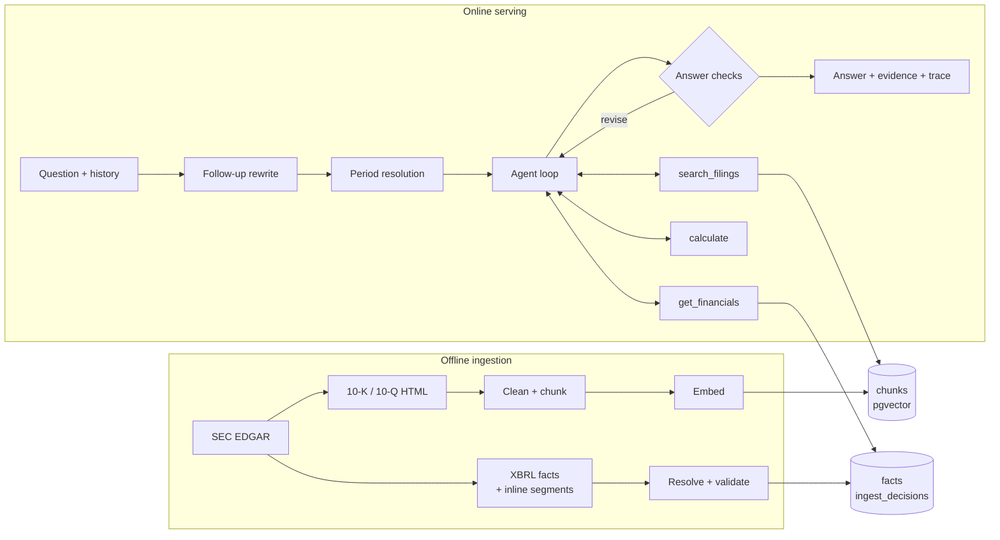
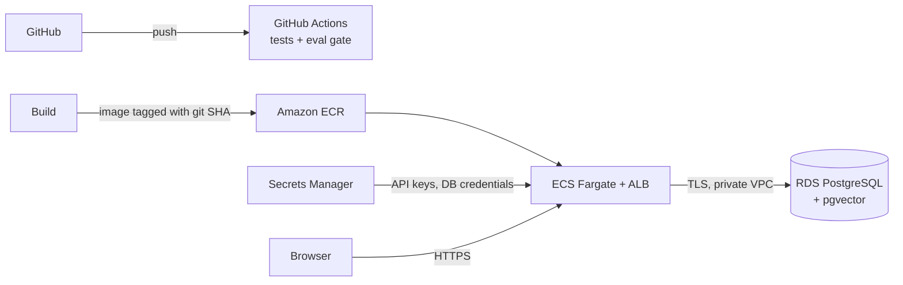

# Earnings RAG

[](https://github.com/dennisdang5/earnings-rag/actions/workflows/ci.yml)

A tool-using agent that answers questions about SEC filings (10-K and 10-Q) for NVIDIA, Apple and Capital One. Answers are grounded only in what the companies reported, and every claim and figure is cited.

**Live demo:** [ea-f1d2aa79276a44b6bd633fd808d49629.ecs.us-east-1.on.aws](https://ea-f1d2aa79276a44b6bd633fd808d49629.ecs.us-east-1.on.aws/)

The agent combines three sources of truth:

- **Semantic search** over filing text (pgvector)
- **Structured financial facts** parsed from XBRL
- **A sandboxed calculator**, so the model never does arithmetic itself

Citations are verified in code before an answer reaches the user.

---

## Tech stack

| Layer | Tools |
|---|---|
| Language | Python 3.11 |
| Data sources | SEC EDGAR: filings, companyfacts XBRL, calculation and label linkbases |
| Parsing | BeautifulSoup, lxml |
| Embeddings | OpenAI `text-embedding-3-small` |
| Storage | PostgreSQL + pgvector |
| LLM | OpenAI `gpt-4o-mini` (agent), `gpt-4o` (eval judge) |
| Agent runtime | Custom tool-calling loop on the OpenAI SDK |
| API | FastAPI, Pydantic, Server-Sent Events |
| Frontend | Vanilla HTML / JavaScript |
| Observability | Prometheus, structlog |
| Infrastructure | Docker, GitHub Actions, AWS ECR / ECS Fargate / RDS / Secrets Manager |

---

## System overview



The system has two halves:

- **Ingestion** turns raw filings into two stores: embedded text chunks, and a table of normalized, validated financial facts.
- **Serving** runs a bounded agent loop over those stores. It streams progress to the client and returns the answer together with the evidence and the full execution trace.

---

## Ingestion

### Filing text

| Stage | What it does |
|---|---|
| Download | Resolves tickers to CIKs, walks the filing history, and caches each 10-K and 10-Q primary document |
| Clean | Strips the inline-XBRL header, unwraps inline tags, removes tables and page furniture, and trims front matter (a 10-K from Item 1, a 10-Q from Part I) |
| Chunk | 500-token windows with 50 tokens of overlap. Each chunk is labelled with `form`, `fiscal_year` and `fiscal_period` from the company's fiscal calendar |
| Embed + store | `text-embedding-3-small` vectors in pgvector, searched with exact cosine distance, filterable by company and filing |

### Financial facts

Figures are read from XBRL, not from prose, and stored in a single `facts` table:

- **Normalization.** Each value's period is labelled from the fact's own dates, and duplicates resolve to the latest report. Missing quarters, including Q4, are derived from year-to-date totals and flagged as derived.
- **Concept resolution.** For each company, every metric (revenue, net income, EPS, loans, …) is mapped to an XBRL concept from that company's own data. Candidate synonyms are cross-checked against accounting identities and against the income statement in the calculation linkbase.
- **Split adjustment.** Stock splits are detected from jumps in the cover-page share count and corroborated against restated figures. Per-share values are rescaled to today's share basis, and the as-reported value is kept alongside.
- **Breakdowns.** Product, segment and geography slices (iPhone, Data Center, Credit Card, Greater China, …) are parsed from the inline XBRL of each filing. They are named from the filing's label linkbase and reconciled against consolidated totals.
- **Validation gates.** A ticker is not stored if its parsed values disagree with the SEC API, if its split readings are inconsistent, or if a core metric can't be resolved. Every resolution decision is recorded in `ingest_decisions` for auditability.

Current corpus: 4,409 text chunks and 2,575 facts across 12 10-Ks and 43 10-Qs.

---

## Agent

The agent loop (`earnings_rag/agent/loop.py`) runs as follows:

1. Call the model.
2. Execute any tool calls it requests and append their results to the conversation.
3. Repeat, up to a fixed step budget. When the budget runs out, a final answer is forced with tools disabled.

The loop is written directly on the OpenAI SDK with no framework, so every message and stop condition stays explicit.

### Tools

| Tool | Purpose |
|---|---|
| `search_filings(query, company, fiscal_year, period, latest)` | Vector search over filing text, scoped to a 10-K, a specific 10-Q, or the most recent filing. A request for a filing that doesn't exist returns the filings that do. |
| `get_financials(company, metric, fiscal_year, period, breakdown)` | Structured figures with stable ids (`NVDA_revenue_FY2025Q4`). Can return product, segment or geography breakdowns. Flags incomplete fiscal years and metrics the company does not report. |
| `calculate(expression)` | Arithmetic evaluated through an AST allowlist (no `eval`). Each result gets an id (`calc_1`) so computed numbers can be cited. |

Each tool is a Pydantic argument model plus a function. The same model generates the JSON schema sent to the LLM and validates the arguments it returns. Tool failures come back to the model as structured errors rather than exceptions.

### Context and pre-processing

- **Date context.** The system prompt carries today's date and each company's latest available filings.
- **Period resolution.** Relative periods ("last quarter", "next fiscal year", "last year") are resolved deterministically against each company's fiscal calendar before the model sees the question.
- **Follow-ups.** A follow-up such as "And Apple?" is rewritten into a standalone question from recent turns, using a lightweight model call. Conversation state is held by the client, so the server stays stateless.

### Answer verification

Before an answer is returned, a deterministic checker (`agent/citations.py`) validates it. It flags:

- figures stated without a citation
- cited ids that no tool returned
- figures that the cited fact or calculation does not actually state
- company-wide totals cited as product or segment figures
- requested filings that don't exist and that the answer doesn't acknowledge as missing

A failing draft goes back to the model once with targeted repair instructions. Any issue that remains is surfaced to the user rather than hidden.

---

## Interface

The UI is a single page (`earnings_rag/static/index.html`) backed by `POST /agent/stream`.

- **Conversational thread** with follow-up support and a home screen of company cards (latest revenue, newest filings, example questions)
- **Live progress:** each tool call streams as a step while the agent works
- **Citation chips** that open evidence cards: the passage text, or the fact's value, period, source filing and caveats (derived, split-adjusted, balance date)
- **Charts** of the cited figures, drawn only from facts the answer cites
- **"How this was computed" panel:** check results, resolved periods, the interpreted question, each tool call with its raw output, the ingest decisions behind the figures, and token cost

All model and filing text is rendered as DOM text nodes; nothing is inserted with `innerHTML`.

---

## Evaluation

| Layer | Method | Result |
|---|---|---|
| Retrieval (annual) | recall@5 on hand-verified anchor phrases | 0.864 |
| Retrieval (quarterly) | recall@5 with filing filters, plus a wrong-filing check | 0.875 |
| Refusals (fixed pipeline) | False and missed refusals on in- and out-of-corpus questions | 0 / 0 |
| Agent behaviour | 35 scenarios × repeated runs: expected figures, tool usage, filing selection, citation flags, multi-turn interpretation | Run → store → score |
| Groundedness | `gpt-4o` judge: per-claim support, citation correctness and answer relevance, validated against human labels | 93% agreement |

- Ground truth uses **anchor phrases** (verbatim text from the answering passage) rather than chunk ids, so labels survive re-chunking.
- Agent runs are **stored and scored separately**. Scorers can change and runs can be compared without new model calls.
- A **parameter sweep** harness compares step budget and output-token limits against quality and cost.

### CI

GitHub Actions runs the test suite and the retrieval eval on every push. The build fails if recall drops below 0.75.

CI is fully hermetic: no API keys and no network calls. It uses:

- a committed fixture corpus with precomputed embeddings
- a scripted fake LLM client for the agent loop

Live agent evals run manually.

```bash
pytest
python eval/run_eval.py --match anchor --offline     # retrieval, as CI runs it
python eval/run_agent_eval.py --repeats 3            # live agent runs -> eval/runs/
python eval/score_agent_eval.py                      # score stored runs
python eval/judge_runs.py eval/runs/<run>.jsonl      # LLM-judge scores
```

---

## Running locally

**Prerequisites:** Python 3.11+, Docker, an OpenAI API key, and an SEC user agent string.

```bash
git clone https://github.com/dennisdang5/earnings-rag.git
cd earnings-rag
cp .env.example .env            # add OPENAI / EMBEDDING key and SEC_USER_AGENT

python -m venv .venv
source .venv/bin/activate       # Windows: .venv\Scripts\Activate.ps1
pip install -r requirements.txt && pip install -e .

docker compose up -d db         # Postgres + pgvector on localhost:5433
```

Build the corpus:

```bash
python -c "from earnings_rag.ingest import ingest_all; ingest_all()"           # 10-Ks
python -c "from earnings_rag.ingest import ingest_quarters; ingest_quarters()" # 10-Qs
python -m earnings_rag.xbrl                                                    # facts and breakdowns
python -c "from earnings_rag.chunking import chunk_all; chunk_all()"           # chunk text
python earnings_rag/pipeline.py                                                # embed and store
```

Run:

```bash
uvicorn earnings_rag.api:app --reload                  # UI at :8000, OpenAPI docs at :8000/docs
python -m earnings_rag.agent "your question"           # CLI, prints the tool trace
docker compose up --build                              # everything in containers
```

### API

| Endpoint | Description |
|---|---|
| `POST /agent/stream` | Agent answer over SSE: progress events, then the answer and a `details` payload (trace, checks, usage, ingest decisions). Accepts optional conversation `history`. |
| `GET /companies` | Company summaries for the home screen |
| `POST /ask`, `POST /ask/stream` | Baseline single-shot RAG pipeline |
| `GET /chunks/{id}` | Full text of a passage |
| `GET /health` | Liveness |
| `GET /metrics` | Prometheus metrics (request counts, latency, retrieval distance, agent duration) |

---

## Deployment



- **Immutable images:** each image is tagged with its git commit SHA.
- **Secrets:** injected from Secrets Manager at container start, through a least-privilege execution role.
- **Database access:** RDS accepts connections only from the service's security group, over TLS.
- **Rollback:** automatic, triggered by a CloudWatch error-rate alarm.
- **Scaling:** the API is stateless, so any task can serve any request.

---

## Repository layout

```
earnings_rag/
  config.py           all tunables (models, chunking, top-k, agent budgets)
  ingest.py           EDGAR download and caching
  chunking.py         HTML cleaning and token chunking
  embeddings.py       embedding client
  store.py            schema, vector search, fact queries
  xbrl.py             XBRL normalization, periods, split adjustment
  resolver.py         per-company metric -> concept resolution
  statements.py       income statement from the calculation linkbase
  segments.py         product / segment / geography breakdowns
  labels.py           breakdown names from the label linkbase
  periods.py          relative period resolution
  calc.py             sandboxed arithmetic
  agent/
    loop.py           agent loop
    tools.py          tool definitions
    citations.py      answer verification
    followup.py       follow-up rewriting
  agent_stream.py     agent -> SSE events
  agent_eval.py       agent eval scoring
  agent_judge.py      LLM-as-judge
  agent_sweep.py      parameter sweeps
  pipeline.py, llm.py baseline RAG pipeline
  api.py              FastAPI app, metrics, logging
  static/index.html   web UI
eval/                 questions, eval runners, judge validation, CI fixture
tests/                hermetic unit and integration tests
DECISIONS.md          design log
```
